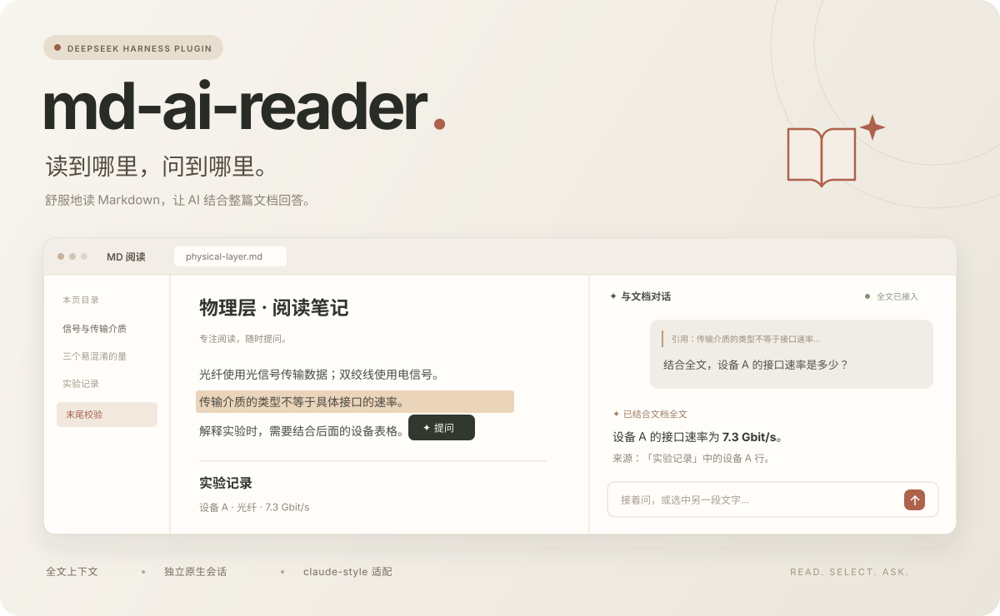

<div align="center">

# md-ai-reader

### 读到哪里，问到哪里。

**让 Markdown 在 DSH 里读得舒服，也问得明白。**

A focused Markdown reader with document-aware, native DSH conversations.

[](https://github.com/tobyberry666/md-ai-reader/actions/workflows/checks.yml)
[](https://github.com/tobyberry666/md-ai-reader/releases)


[开始使用](#开始使用) · [下载插件](https://github.com/tobyberry666/md-ai-reader/releases/latest) · [工作原理](#它怎样理解文档) · [验证记录](docs/contracts.md)



<sub>上图为功能示意。实际聊天区复用 DSH 原生组件，外观随你的主题和插件变化。</sub>

</div>

## 让阅读不中断

读讲义、看技术文档、啃一份长长的 README，问题总会在某一段冒出来。

**md-ai-reader** 把阅读器和 AI 放在同一页：左边专注阅读，右边随时提问。选中一句话，点一下「提问」，再补上你的问题。AI 回答时能结合整篇原文，包括你还没翻到的章节。

> 选中「传输介质的类型不等于具体接口的速率」，问：
>
> **“结合后面的实验记录，设备 A 的接口速率是多少？”**
>
> AI 可以引用后文设备表中的 **7.3 Gbit/s**，并指出来源。

## 一页里，把阅读和理解接起来

| | 你能做什么 |
| --- | --- |
| 📖 **舒服地读** | 独立「MD 阅读」页面，双栏可调宽度，目录、搜索、字号调节与深浅主题。 |
| ✨ **选中就问** | 正文、代码或表格里的文字都可插入右侧原生引用，补充问题后发送。 |
| 🧠 **结合全文** | 每次文档会话接入完整原文；超出模型窗口会报错，不用截断内容冒充全文。 |
| 💬 **用你熟悉的 DSH** | 复用原生模型选择、聊天、流式回答、停止、工具及权限机制，无需另填 API Key。 |
| 🗂️ **每篇单独聊** | 文档关联独立会话；切换时保留各自的草稿、聊天历史和阅读位置。 |
| 🪄 **打开就能读** | 选择或拖入 `.md` / `.markdown`，支持表格、代码高亮、公式与相对路径图片。 |

**导入、阅读和选择文字不会调用模型。** 发送问题时，全文进入当前 DSH 模型的上下文，沿用你现有账号的调用与计费方式。

## 开始使用

目前在 **Windows / DSH Desktop 0.2.1-rc.2 / claude-style 0.16.2** 上完成实测。

1. 在 [Releases](https://github.com/tobyberry666/md-ai-reader/releases/latest) 下载 `dsh-md-reader-0.1.6.tgz`。
2. 在下载目录打开 PowerShell，使用 DSH 自带的 CLI 安装：

   ```powershell
   & "$env:LOCALAPPDATA\Programs\DeepSeek Harness\resources\runtime\cli\bin\dsh.cmd" plugin --profile desktop add ".\dsh-md-reader-0.1.6.tgz"
   ```

3. 从托盘退出 DSH，再重新打开，点击左侧 **「MD 阅读」**。
4. 拖入 Markdown，选中文字，点击 **「提问」**；也可以直接询问全文。

<details>
<summary>为什么下载包叫 dsh-md-reader？</summary>

项目对外名称为 **md-ai-reader**。为了兼容已有安装、文档库和会话映射，内部插件标识及包名保留为 `dsh-md-reader`。它们是同一个插件。

卸载命令为：

```powershell
& "$env:LOCALAPPDATA\Programs\DeepSeek Harness\resources\runtime\cli\bin\dsh.cmd" plugin --profile desktop remove dsh-md-reader
```

卸载保留文档库与原生会话历史。

</details>

## 它怎样理解文档

**一篇 Markdown → 一个独立 DSH 会话 → 完整原文上下文 + 本次引用与问题。**

插件在 DSH 内注册独立阅读页，并把聊天区绑定到当前文档的原生会话。全文通过 DSH 必需的 user-role runtime context 接入，保留原始字面内容，不进行变量插值、自动摘要或静默截断。

文档快照与阅读位置保存在 DSH home 的 `dsh-md-reader/documents/`；聊天历史继续使用 DSH 存储。与 claude-style 共用时，仅在阅读页内适配模型按钮和窄栏输入区。

### 已验证的，不只是界面

2026-10-22 的安装实测包含 **16 项单元测试、8 组桌面集成检查**，以及原生控件边界和窄窗检查。

- 只选开头的信号段落提问，真实 DSH 模型正确答出后文的 **7.3 Gbit/s** 和末尾的 **ORCHID-7319-K8M**，并给出来源。
- 切换到另一篇文档后，回答变为该文档的 **2.6 Gbit/s / CEDAR-2600-T9P**，未混入上一篇信息。
- 已验证停止生成后继续发送、刷新恢复、独立草稿、相对图片、亮暗主题及恶意 HTML/链接不执行。

模型问答实测使用合成文档和 `deepseek-v4.1-flash-1017`。详细方法见 [验证与原生集成契约](docs/contracts.md)。

### 当前范围

- 支持 UTF-8 Markdown，单文件最多 **2 MiB**。
- 文档是导入时的快照；内容变更后重新导入，会关联新的会话。
- 相对图片需要原 Markdown 路径和图片文件仍然可用。
- 全文按 UTF-8 字节数加 32768 token 对话预留进行保守窗口检查；模型适配器没有窗口元数据时，沿用 DSH 原生限制。
- 其他 DSH 版本与扩展组合尚未完整验证。

## 本地开发

需要 Node.js 24 或更新版本。核心测试与构建无需下载依赖，React 和 Markdown 渲染器使用 DSH 运行时。

```powershell
npm test
npm run build
npm pack
```

桌面测试另外需要 Playwright 和已启动、开放本机调试端口的 DSH：

```powershell
npm install --no-save --package-lock=false playwright@1.64.0
# DSH_CDP 默认为 http://127.0.0.1:9237
node test/installed-smoke.mjs
npm run test:browser
```

桌面检查不自动发送模型请求。`scripts/restart-test-desktop.ps1` 仅管理固定目录的隔离测试实例；`-StopOnly` 用于关闭该实例。

---

<div align="center">

**一边阅读，一边把问题想明白。**

Built for focused reading. Powered by your DSH.

</div>
